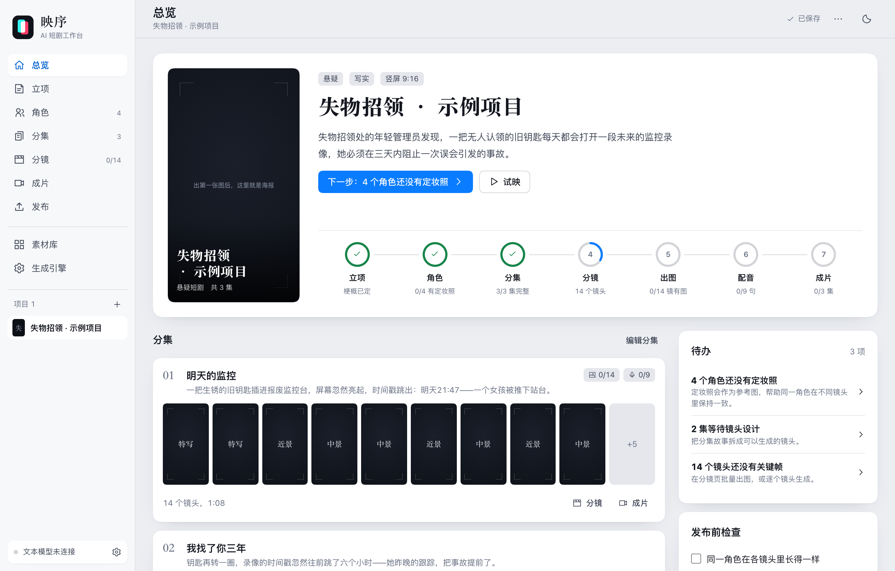

# 映序 Studio · AI 短剧工作台

DeepSeek Harness 的 AI 短剧制作插件。从一句话梗概开始，依次完成角色定妆、分集、分镜出图、配音，最后在本机合成一条可以发布的 9:16 竖屏 MP4。

0.3 版把原来的「分镜表」扩成了一条完整的制作流水线；0.4 版在发布页加了平台选择（抖音 / B站 / 快手 / 视频号）和按平台规则做的检查。项目数据格式向前兼容，0.2 的项目可以直接打开。



## 在线演示

不装 Harness、不填 Key，先在浏览器里看界面：<https://qingshui59.github.io/dsh-drama-board/>

示例项目《失物招领》可以直接点开每一页、改文字，改动存在浏览器的 localStorage 里，刷新还在，底部的「重置示例」可以恢复原样。出图、配音、合成需要本机后端，演示页里会给出提示；要完整使用请往下看安装步骤。

## 制作流程

| 页面 | 做什么 |
| --- | --- |
| 总览 | 海报、七步进度（立项→角色→分集→分镜→出图→配音→成片）、每集的画格条和待办 |
| 立项 | 剧名、梗概、题材、画风、影调（6 种色彩倾向）、补充风格词 |
| 角色 | 固定外貌、AI 定妆照（保留历史版本，可上传）、每个角色的配音音色 |
| 分集 | 每集的钩子、冲突、卡点 |
| 分镜 | 画格墙 + 镜头检查器：出图、画草图、上传、切换版本、配音、图生视频；也有表格视图和 Markdown / CSV 导出 |
| 成片 | 试映播放器（按运镜做动效、同步字幕和配音）、胶片时间线、批量配音、配乐、合成 MP4 |
| 发布 | 抖音 / B站 / 快手 / 视频号任选一个，按平台字数限制检查标题、简介和话题，AI 写文案，选封面，复制发布包，下载成片 |
| 素材库 | 这个项目生成过的全部图片、视频、配音和成片 |
| 生成引擎 | 选择出图、视频、配音各用哪一家，填写 API Key，测试连通 |

## 发布平台

「发布」页可以选抖音、B站、快手、视频号四个平台。选中后标题字数上限、话题数量、封面比例都按那家的规矩来，右上角「发布检查」会列出必须改的（成片没合成、标题超长）和建议改的（没封面、没话题）。

四家的接口情况不一样，工作台只做「检查 + 复制文案 + 打开后台」，没有代替你点发布：

| 平台 | 官方发布接口 | 现状 |
| --- | --- | --- |
| 抖音 | 有。`upload_video` → `create_video`（scope `video.create.bind`） | 要企业主体入驻开放平台，在「能力实验室」开通「代替用户发布内容到抖音」，发布时账号本人授权；权限收得紧，个人开发者基本拿不到 |
| B站 | 有。上传预处理 → 分片上传 → 合片 → 封面上传 → 稿件提交 | 要入驻开放平台、创建应用，走 OAuth 与 HMAC-SHA256 签名，个人 UP 主也可以申请 |
| 快手 | 有。`start_upload` → 上传 → `publish`（scope `user_video_publish`） | 要企业资质和单独的发布权限，审核通过后才能调 |
| 视频号 | 没有。官方社区明确答复「目前没有」代替用户发布视频的接口 | 视频号助手的 AppID/AppSecret 只开放直播数据、橱窗商品等能力；发视频只能在网页版助手手动上传 |

接口接通之前，发布流程是：复制发布包 → 打开创作中心 → 上传成片 → 粘贴文案，一分钟左右。要真接自动发布，需要先在开放平台建应用、拿到 AppID/AppSecret、配好回调地址，再在工作台里加入授权与上传逻辑；没有应用凭证这步做不了。

## 生成引擎

不填任何 Key 也能跑通全流程：本地分镜草图占位 → 系统语音配音 → 本地运镜动效 → ffmpeg 合成。要出真实画面，在「生成引擎」里接入下面任意一家。

| 能力 | 可选引擎 |
| --- | --- |
| 写剧本 | Harness 当前模型（默认，不用填 Key）；或自己的 DeepSeek / 智谱 / 硅基流动 / OpenAI 兼容接口 |
| 出图 | 火山方舟 Seedream（即梦同款，支持定妆照参考图）、智谱 CogView / GLM-Image、硅基流动 Kolors（免费）、Pollinations、OpenAI 兼容接口 |
| 动态 | 本地运镜动效（默认）；火山方舟 Seedance、智谱 CogVideoX（flash 免费）、硅基流动、可灵 |
| 配音 | macOS 系统语音（默认）；硅基流动 CosyVoice、OpenAI 兼容接口 |
| 合成 | 本机 ffmpeg（需要带 libx264 或 VideoToolbox；带 libass 才有字幕） |

接口参数按各家官方文档在 2026-11-16 核对过，请求体有自动化测试覆盖。2026-11-19 用真实的硅基流动 Key 跑通了「出图 → 图生视频」这条链：Kolors 关键帧 8 秒出图；MiniMax-H3（5 秒、768p、9:16）2 分 21 秒出片，文件 768×1376、24fps、5.17 秒，自带一条环境音轨。火山方舟、智谱、可灵的云端出图和图生视频仍未实际调用过，第一次使用时先点「出一张测试图」。其中可灵新版接口的首帧图片按不带前缀的 base64 发送，文档对此没有写明，如果报图片格式错误，改用 `kling-v2-6`（旧版接口，格式有明确文档）。

角色一致性靠两层：出镜角色的固定外貌由程序逐字拼进提示词（不依赖模型自己记得抄），检查器里可以看到「实际发送的提示词」；用火山方舟时，角色定妆照还会作为参考图一并传入。

## 安装 ffmpeg

合成需要 ffmpeg。macOS：

```bash
brew install ffmpeg
```

从访达启动的 Harness 看不到 Homebrew 的 PATH，插件会自己到 `/opt/homebrew/bin`、`/usr/local/bin` 找；找不到时在「生成引擎 → 合成」里填完整路径。

## 在 Harness 中使用

在插件管理器中安装当前目录，或沿用 `dsh plugin --profile desktop add dsh-drama-board`。当前工作区是通过本地目录链接安装的。

**从 0.2 升级后需要重启一次 Harness**：后端（`index.js` 与 `host/`）在启动时加载，只刷新页面读到的是新界面加旧后端，这时页面顶部会提示「后端还是旧版本」。

## 独立运行

不装 Harness 也能用完整的工作台。Node.js 18 以上：

```bash
cd dsh-drama-board
npm run dev
```

打开 [http://127.0.0.1:4173](http://127.0.0.1:4173/preview/index.html)。第一次启动会放入一个示例项目。独立运行时没有 Harness 的模型，需要到「生成引擎 → 写剧本」填自己的文本模型 Key；其余功能与插件内一致。数据在 `~/.dsh/drama-board-preview/`，与 Harness 里的项目互不影响。可用 `DRAMA_PREVIEW_PORT`、`DRAMA_PREVIEW_HOME` 换端口和数据目录。

## 数据在哪里

```
~/.dsh/drama-board/
  projects.json   工作区（文字与素材引用）
  settings.json   引擎配置与 API Key（权限 600，页面只能拿到掩码）
  media/<项目>/   图片、视频、配音、成片，以及记录来源的 index.json
  api.log         接口诊断日志
```

路径依次使用 `$DSH_HOME`、`$DSH_PROFILE_DIR` 的上一级、`~/.dsh`。JSON 备份只含文字和素材引用，换电脑时要连同 `media/` 一起复制。删除项目不会删除它的素材文件，可以在素材库里逐个删除。

## 开发

界面源码在 `src/`，没有打包器：`scripts/build.mjs` 把各个 `.js` 按文件名顺序拼进一个工厂函数，连同 `styles.css` 生成 Harness 加载的 `client.js`。**改了 `src/` 之后要运行 `npm run build`**，不要直接改 `client.js`。

GitHub Pages 的在线演示在 `docs/`：`index.html` 里写了一个把 `/drama-board/api` 请求接住的假后端，`npm run build:demo` 负责同步 `client.js`、React 和示例数据（`demo-data.js`）。示例项目取自 `preview/demo.json`，引擎目录直接读 `host/providers.js` 的 `CATALOG`。

```
index.js            Harness 接线：挂载路由，复用 ctx.llm
host/app.js         与宿主无关的后端：路由、设置、任务处理
host/providers.js   云端出图 / 图生视频 / 配音 / 文本的适配
host/studio.js      本机制片：系统语音、运镜、字幕、ffmpeg 合成
host/media.js       素材存储与带 Range 的文件服务
host/jobs.js        后台任务队列（出图 2 并发，合成 1 并发）
host/prompts.js     写剧本的提示词
src/                界面：00 数据层 → 20 组件 → 40 状态 → 5x 页面 → 90 外壳
preview/server.mjs  独立运行的服务
```

接口都在 `/drama-board/api` 下：`state`、`generate`、`settings`、`settings/test`、`jobs`、`jobs/cancel`、`jobs/ack`、`assets`、`media/<项目>/<文件>`、`media/upload`、`media/delete`。写请求会拒绝来自其他网站的跨站调用。

## 验证

```bash
npm run check                                        # 构建并检查语法
node ../test-results/2026-11-16-studio/verify.mjs    # 35 项后端回归，不联网、不需要 Key
```

`test-results/2026-11-16-studio/` 里还有界面全流程脚本 `ui-flow.mjs`（配合 `mock-ai.mjs` 模拟文本和出图服务）、各页面截图和一段用本地草图合成的样片。`test-results/2026-11-14/` 与 `ios-redesign/` 是 0.1、0.2 的历史记录，其中的脚本针对旧界面和旧路由，不再适用。

## 已知限制

- 系统语音只在 macOS 可用，音色偏机械；要自然的人声请接云端配音。
- 本地运镜动效只是对静态关键帧做推拉摇移，人物不会动；要人物动作请接图生视频。
- 云端图生视频会自带环境音轨（硅基流动 MiniMax-H3 已实测），合成成片时统一丢弃，只保留配音和配乐；输出按模型档位（768p 的 9:16 是 768×1376），合成时按 720×1280 画布轻微裁切，多出来的 0.17 秒也会按镜头时长裁齐。MiniMax-H3 按 0.5 元/秒计费，5 秒约 2.5 元。
- 撤销只有一步，恢复的是操作前的整个工作区快照；长期恢复请用备份。
- 重新生成分集会清空原分镜和它们的画面引用（文件仍在素材库）。
